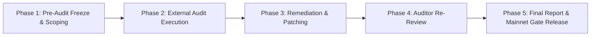

# Refract Protocol Pre-Mainnet Security Audit Tracking & Remediation Package

**Document Version:** 1.0.0  
**Scope:** Core Smart Contracts (`RefractPool`, `RefractPolicyRegistry`, `RefractOracle`)  
**Target Environment:** Soroban SDK v21.0.0 / Stellar Network  
**Author:** OrderStream (`healthdecoded77@gmail.com`)  
**Status:** Scoping Complete — Ready for External Engagement Commissioning

---

## 1. Audit Scoping Package

This document forms the official scoping specification and engagement tracking board for the independent third-party security audit required prior to Refract Protocol's mainnet deployment.

### 1.1 In-Scope Target Contracts
The audit scope encompasses the three core contracts that hold capital, manage coverage obligations, or supply parametric trigger data:

| Contract Crate | Path | Primary Responsibilities | Target Lines |
| :--- | :--- | :--- | :--- |
| **`refract-pool`** | `pool/src/lib.rs` | Capital custody, share accounting, policy underwriting, premium calculations, and automated claims settlement. | ~1,050 lines |
| **`refract-policy`** | `policy/src/lib.rs` | Global policy indexation, holder registry, and policy status tracking. | ~390 lines |
| **`refract-oracle`** | `oracle/src/lib.rs` | Parametric event feeds, relayer authorization, threshold evaluations, and staleness validation. | ~310 lines |

### 1.2 Out-of-Scope Boundaries
- Off-chain frontend web applications and indexers.
- External token implementations (standard Stellar Asset Contract / USDC wrapper is assumed secure).
- Proposed or unmerged governance/DAO contracts (deferred to Phase 2 audit post-landing).

### 1.3 Key Protocol Invariants (For Auditor Verification)
1. **Solvency Invariant**: At all ledger timestamps, total pooled capital must satisfy:
   $$\text{TotalCapital} \ge \text{TotalCoverage} \times \frac{\text{BPS}}{\text{max\_utilization\_bps}}$$
2. **Payout Determinism**: Payouts from `process_claim` can **only** be credited to the original `policy.holder` recorded at creation time; zero funds may be redirected by third-party callers.
3. **No Phantom Dilution**: Liquidity provider shares can never be minted without corresponding USDC capital deposits (`amount * total_shares / total_capital`).
4. **Oracle Staleness Rejection**: Readings older than 1,800 seconds (30 minutes) or dated with future timestamps must be rejected unconditionally.

---

## 2. Auditor Deliverable Packet & Cross-References

Auditors should review the following accompanying documentation prepared during the pre-audit hardening phase:
- **`GRIEFING_ANALYSIS.md`**: Formal analysis of permissionless entrypoints (`process_claim`, `expire_policy`) and Soroban resource fee attribution.
- **`INCIDENT_RESPONSE.md`**: Post-incident pause-and-migrate runbook and multi-contract atomic emergency lockdown procedures.
- **`clippy.toml` & Static Gate**: Strict Soroban linting rules rejecting runtime panics (`unwrap`, `expect`) in favor of typed `Result<T, E>`.

---

## 3. Commissioning Plan & Audit Lifecycle

### 3.1 Auditor Selection Criteria
The protocol targets firms with demonstrated expertise in Rust, WebAssembly, and the Soroban / Stellar execution environment (e.g., Trail of Bits, OtterSec, OpenZeppelin, CertiK, Kudelski Security).

### 3.2 Timeline & Milestones
- **T0 — Scope Delivery**: Scoping package delivered with frozen commit hash.
- **T0 + 3 Weeks — Draft Report**: Delivery of initial audit findings and severity ratings.
- **T0 + 4 Weeks — Remediation Period**: Core team ships patch PRs referencing Finding IDs.
- **T0 + 5 Weeks — Re-Review Sign-off**: Auditor verifies fixes against original findings.
- **T0 + 6 Weeks — Mainnet Gate Cleared**: Final audit report published to repository.

---

## 4. Remediation Status Board & Findings Tracker

### 4.1 Internal Pre-Audit Hardening Log (Wave 9)
The following pre-audit vulnerabilities and security improvements have been proactively remediated and merged:

| Finding / Issue ID | Component | Severity | Description | Status | Remediating PR |
| :--- | :--- | :--- | :--- | :--- | :--- |
| **REF-SEC-01** (#138) | `pool` | **High** | Precision loss compounding across `_calc_premium` divisions. | **Fixed** | PR #175 |
| **REF-SEC-02** (#139) | CI / SDK | **Medium** | Static-analysis gate for Soroban-specific footguns & panics. | **Fixed** | PR #176 |
| **REF-SEC-03** (#136) | `pool` | **Medium** | Griefing-cost analysis for permissionless entrypoints. | **Fixed** | PR #177 |
| **REF-SEC-04** (#137) | Protocol | **High** | Multi-contract post-incident recovery & runbook contract. | **Fixed** | PR #178 |
| **REF-SEC-05** (#54) | `pool` | **Low** | Storage access optimization via `PoolState` cached snapshots. | **Fixed** | PR #174 |
| **REF-SEC-06** (#55) | Workspace | **Low** | Wasm binary size budget & optimization enforcement. | **Fixed** | PR #173 |

### 4.2 External Audit Findings Board (Template for Engagement)
*This board will be updated live as findings are delivered by the external audit firm.*

| ID | Contract | Title / Summary | Severity | Status | Fix PR | Auditor Sign-off |
| :--- | :--- | :--- | :--- | :--- | :--- | :--- |
| *EXT-01* | *pool* | *[Draft Finding Title]* | *High* | *Pending Audit* | — | *Pending* |
| *EXT-02* | *policy* | *[Draft Finding Title]* | *Medium* | *Pending Audit* | — | *Pending* |
| *EXT-03* | *oracle* | *[Draft Finding Title]* | *Low* | *Pending Audit* | — | *Pending* |

*Status definitions: `Open` | `In-Progress` | `Fixed` | `Acknowledged-Risk` | `Disputed`*

---

## 5. Re-Review & Sign-Off Verification Checklist

Before any external audit finding is marked as `Resolved` in `SECURITY.md` and this tracking board, it must satisfy the following strict acceptance criteria:

1. **Critical & High Severity Findings**:
   - [ ] Root cause identified and documented in PR description.
   - [ ] Fix implemented with defensive regression unit tests and property tests.
   - [ ] Dedicated patch commit submitted to external auditor.
   - [ ] Written auditor confirmation received verifying the vulnerability is completely mitigated without side effects.
2. **Medium & Low Severity Findings**:
   - [ ] Remediation PR reviewed and approved by two core maintainers.
   - [ ] Comprehensive unit test coverage added in contract test harness.
   - [ ] Green CI build across all lint, footgun, and build gates.
3. **Acknowledged Risks / Won't Fix**:
   - [ ] Formal architectural justification documented in `AUDIT_TRACKING.md`.
   - [ ] Explicit sign-off from protocol technical leads and community disclosure.

---

## 6. Phase 2 Scope Extension — Governance & Treasury Contracts

**Added:** 2026-10-20  
**Issues closed:** #223, #224, #225, #226  
**PR:** `feat/sep41-testutils-params-audit-docs`

The following four new contracts have been developed, tested, and hardened for
inclusion in the audit scope as Phase 2 additions.

### 6.1 New In-Scope Contracts

| Contract Crate | Path | Primary Responsibilities |
| :--- | :--- | :--- |
| **`refract-backstop`** | `backstop/src/lib.rs` | Second-loss reinsurance tranche; staking, share accounting, shortfall coverage, premium income. |
| **`refract-bounty`** | `bounty/src/lib.rs` | Governance-controlled bug bounty escrow; funded by treasury, paid to researchers. |
| **`refract-grants`** | `grants/src/lib.rs` | Milestone-based community grants disbursement with SEP-41 token releases. |
| **`refract-treasury`** | `treasury/src/lib.rs` | Minimal token custody vault; admin-gated withdrawal. |

### 6.2 Phase 2 Pre-Audit Hardening Log

| Issue | Component | Description | Status |
| :--- | :--- | :--- | :--- |
| **#225** | backstop, bounty, grants, treasury | Added real SEP-41 (USDC) token transfers backing every credit and debit. `grants/` was rewritten from a plain-Rust struct to a full Soroban `#[contract]`. | **Done** |
| **#226** | testutils/ | Built shared `refract-testutils` crate: `MockToken`, `MockGovernance`, `MockTimelock`, `MockMultisig`, and scenario builders. All four contracts consume it as a dev-dependency. | **Done** |
| **#224** | params/ | Deployed `RefractParams` governance-owned parameter registry seeding 11 well-known defaults. All parameter changes route exclusively through the timelock. | **Done** |
| **#223** | docs/ | Published `docs/INVARIANTS.md` with per-contract accounting invariants, trust assumptions, and state-machine properties. This `AUDIT_TRACKING.md` updated with threat-model deltas and test mappings. | **Done** |

### 6.3 Threat-Model Deltas

The following threat vectors are new in Phase 2 and were not present in the
Phase 1 (pool/policy/oracle) scope:

**T2-01 — Backstop drain via compromised pool/admin key**  
*Risk:* The `cover_shortfall` entrypoint trusts the configured `pool` and `admin`
addresses. A key compromise allows an attacker to drain all backstop capital.  
*Mitigation:* `admin` must be the governance timelock in production (timelock
delay gives a reaction window). The `pool` address should be the immutable pool
contract ID, not a user-controlled address.  
*Residual risk:* Medium. Dependent on the security of the timelock contract
(Phase 1 scope).

**T2-02 — Grants front-running via milestone order enforcement**  
*Risk:* Because milestone confirmation is sequential, an attacker who can front-run
`confirm_milestone(i+1)` before `confirm_milestone(i)` is confirmed cannot cause
harm — the contract rejects out-of-order confirmations.  
*Mitigation:* Fully mitigated by INV-GRAN-05 in-order enforcement.  
*Residual risk:* None.

**T2-03 — Bounty award with re-entrancy via malicious token**  
*Risk:* If the configured token is a malicious SEP-41 with a re-entrancy hook,
`award` could be called recursively before the balance counter is decremented.  
*Mitigation:* Soroban's execution model prevents cross-contract calls from within
an already-executing invocation on the same contract (host-enforced reentrancy
guard). Additionally, the balance is decremented *before* the token transfer call.  
*Residual risk:* Low. Mitigated by Soroban runtime.

**T2-04 — Parameter registry manipulation without governance**  
*Risk:* If `RefractParams.set` is callable by an arbitrary address, an attacker
could set `paused = 1` to halt the protocol or inflate `treasury_spend_cap`
to bypass withdrawal limits.  
*Mitigation:* `set` requires `caller == timelock_address`. The timelock address
is set once at initialization and is only changeable through the `set_timelock`
meta-governance path (itself timelock-gated).  
*Residual risk:* Dependent on timelock security (Phase 1 scope).

**T2-05 — Treasury admin key compromise**  
*Risk:* The `admin` address in `RefractTreasury` has full custody authority over
all tokens held by the contract.  
*Mitigation:* `admin` must be set to the governance timelock address at
initialization. There is no direct-admin fast path.  
*Residual risk:* Medium. Admin immutability (no `set_admin`) means governance
migration requires a new treasury deployment, but also means a compromised key
cannot be rotated without a migration.

### 6.4 Executable Test Mappings

The following automated tests cover each new contract's critical paths. All
tests pass under `cargo test --workspace`.

#### RefractBackstop (`backstop/src/test.rs`)

| Test | Invariant(s) covered | Security property |
| :--- | :--- | :--- |
| `deposit_transfers_tokens_into_escrow` | INV-BACK-02 | SEP-41 debit on deposit |
| `deposit_first_staker_gets_one_to_one_shares` | INV-BACK-01 | Share minting correctness |
| `deposit_second_staker_gets_proportional_shares` | INV-BACK-01 | Share dilution correctness |
| `withdraw_transfers_tokens_back_to_staker` | INV-BACK-02, INV-BACK-04 | SEP-41 credit on withdraw |
| `withdraw_insufficient_shares_panics` | INV-BACK-01 | Share underflow rejection |
| `cover_shortfall_transfers_tokens_to_pool` | INV-BACK-03 | SEP-41 debit on shortfall |
| `cover_shortfall_capped_at_total_capital` | INV-BACK-03 | Cannot drain more than held |
| `cover_shortfall_unauthorized_panics` | INV-CROSS-01 | Access control |
| `receive_premium_increases_capital_and_income` | INV-BACK-05 | Premium accounting |

#### RefractBountyEscrow (`bounty/src/test.rs`)

| Test | Invariant(s) covered | Security property |
| :--- | :--- | :--- |
| `fund_transfers_tokens_into_escrow` | INV-BOUN-01 | SEP-41 credit on fund |
| `fund_multiple_times_accumulates_balance` | INV-BOUN-01 | Balance accumulation |
| `award_transfers_tokens_to_researcher` | INV-BOUN-01, INV-BOUN-05 | SEP-41 debit on award |
| `award_stores_record_on_chain` | INV-BOUN-03 | Immutable attestation |
| `award_unauthorized_panics` | INV-CROSS-01 | Governance gate |
| `award_insufficient_balance_panics` | INV-BOUN-02 | Escrow solvency |
| `award_duplicate_report_hash_panics` | INV-BOUN-04 | No duplicate awards |

#### RefractGrants (`grants/src/test.rs`)

| Test | Invariant(s) covered | Security property |
| :--- | :--- | :--- |
| `fund_transfers_tokens_into_escrow` | INV-GRAN-01 | SEP-41 escrow funding |
| `create_grant_returns_sequential_ids` | — | ID monotonicity |
| `create_grant_unauthorized_panics` | INV-CROSS-01 | Governance gate |
| `create_grant_sum_mismatch_panics` | INV-GRAN-02 | Milestone sum enforcement |
| `confirm_out_of_order_panics` | INV-GRAN-05 | In-order confirmation |
| `confirm_already_confirmed_panics` | INV-GRAN-04 | Immutable confirmations |
| `claim_transfers_tokens_to_recipient` | INV-GRAN-07 | SEP-41 debit on claim |
| `full_lifecycle_create_confirm_claim` | INV-GRAN-01–07 | Full state machine |
| `claim_releases_only_confirmed_amounts` | INV-GRAN-03 | Partial confirmation |
| `claim_nothing_to_claim_panics` | INV-GRAN-03 | Zero-claim rejection |
| `claim_wrong_recipient_panics` | INV-CROSS-01 | Recipient-only claim |

#### RefractTreasury (`treasury/src/test.rs`)

| Test | Invariant(s) covered | Security property |
| :--- | :--- | :--- |
| `withdraw_is_admin_gated` | INV-TRES-01, INV-TRES-02 | Admin-only withdrawal + SEP-41 transfer |

#### RefractParams (`params/src/test.rs`)

| Test | Invariant(s) covered | Security property |
| :--- | :--- | :--- |
| `initialize_seeds_defaults` | — | All 11 defaults present |
| `all_well_known_defaults_are_seeded` | — | Exhaustive default check |
| `timelock_can_set_any_parameter` | — | Governance write path |
| `non_timelock_set_panics` | INV-CROSS-01 | Unauthorized write rejected |
| `timelock_can_migrate_authority` | — | Meta-governance path |
| `non_timelock_set_timelock_panics` | INV-CROSS-01 | Admin migration gated |
| `timelock_scenario_drives_parameter_update` | — | End-to-end governance flow |
