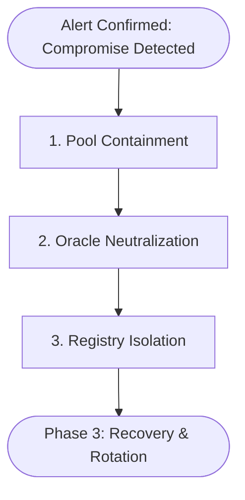

# Refract Protocol Incident Response Runbook: Admin Key Compromise

**Document Version:** 1.0.0  
**Scope:** `RefractPool`, `RefractPolicyRegistry`, `RefractOracle`, `RefractIncidentResponse`  
**Classification:** Operational Security Runbook (Post-Incident Recovery)  
**Author:** OrderStream (`healthdecoded77@gmail.com`)  
**Target Platform:** Stellar Network / Soroban Smart Contracts

---

## 1. Executive Summary & Threat Model

This runbook defines the formal operational procedures for detecting, containing, and recovering from an emergency where the protocol's administrative private key is leaked, exfiltrated, or actively exploited by a malicious adversary.

### Primary Threat Vectors:
1. **Adversarial Reconfiguration**: Exploitation of `set_pool_config` on `RefractPool` to drop rates to 0, artificially manipulate utilization limits, or invalidate underwriting capacity.
2. **Oracle Manipulation**: Adding malicious relayers (`add_relayer`) on `RefractOracle` to forge synthetic depeg or market crash events and initiate illegitimate policy payouts.
3. **Registry Hijacking**: Disconnecting the authoritative registry via `set_policy_registry` or pointing `set_pool_contract` to a malicious drain contract.
4. **Administrative Hostile Takeover**: Rotating `set_admin` to an adversary-controlled key to permanently lock out legitimate maintainers.

---

## 2. Phase 1: Detection & Signal Identification

Immediate detection of on-chain anomalies is critical to executing the containment playbook before adversary transactions are processed by network validators.

### 2.1 On-Chain Monitoring Signatures
The security monitoring system must listen for the following specific ledger events:

| Contract | Event Symbol | Payload / Topics | Alert Severity | Description |
| :--- | :--- | :--- | :--- | :--- |
| **`RefractPool`** | `ADMIN_SET` | `(symbol_short!("ADMIN_SET"),), (new_admin,)` | **CRITICAL** | An administrative rotation was triggered. If unscheduled, indicates immediate key compromise. |
| **`RefractPool`** | `CFG_SET` | `(symbol_short!("CFG_SET"),), ()` | **HIGH** | Operational pool parameters were altered. Verify against approved governance proposal hashes. |
| **`RefractPool`** | `REG_SET` | `(symbol_short!("REG_SET"), caller), (registry,)` | **CRITICAL** | Active policy registry pointer was redirected. |
| **`RefractOracle`** | `admin_set` | `(Symbol("admin_set"),), (new_admin,)` | **CRITICAL** | Oracle administrator transferred. |
| **`RefractOracle`** | `relayer_added` | `(Symbol("relayer_added"),), (relayer,)` | **HIGH** | New relayer authorized to submit parametric trigger feeds. |
| **`RefractPolicyRegistry`**| `admin_set` | `(Symbol("admin_set"),), (new_admin,)` | **CRITICAL** | Registry administrator transferred. |
| **`RefractPolicyRegistry`**| `pool_contract_set`| `(Symbol("pool_contract_set"),), (pool,)` | **CRITICAL** | Registry trusted pool origin redirected. |

---

## 3. Phase 2: Containment & Operational Sequencing

When compromise is verified, responders must execute containment in strict sequence to prevent value extraction.

### Optimal Multi-Contract Containment Order


1. **Step 1: Pool Containment (`RefractPool`)**:
   - *Objective*: Prevent capital outflow and halt new risk exposure.
   - *Action*: Invoke emergency pause or defensively clamp `PoolConfig` (setting `max_coverage = 0` and `max_utilization_bps = 0`).
2. **Step 2: Oracle Neutralization (`RefractOracle`)**:
   - *Objective*: Prevent fraudulent parametric trigger injection.
   - *Action*: Revoke unverified relayers (`remove_relayer`) to halt price/feed updates.
3. **Step 3: Registry Isolation (`RefractPolicyRegistry`)**:
   - *Objective*: Prevent rogue contract bindings.
   - *Action*: Freeze registry state or verify active pool pointer.

---

## 4. Phase 3: Recovery — Atomic Lockdown vs. Multi-Tx Race

### The Critical Dilemma: The Multi-Transaction Window
In standard manual operations, an incident response team attempting to recover 3 contracts submits 3 separate transactions:
$$\text{Tx}_1: \text{Pool.set\_admin} \longrightarrow \text{Tx}_2: \text{Registry.set\_admin} \longrightarrow \text{Tx}_3: \text{Oracle.set\_admin}$$
Under adversarial time pressure, if the attacker detects the response:
- The attacker can observe $\text{Tx}_1$ in the transaction submission queue or ledger close.
- The attacker races to front-run $\text{Tx}_2$ or $\text{Tx}_3$, rotating the remaining contract admin to their own key or injecting a malicious relayer into `RefractOracle`.

### The Solution: Dedicated Atomic Coordinator (`RefractIncidentResponse`)
To completely eliminate this race condition, `RefractIncidentResponse` bundles cross-contract recovery into **a single atomic transaction**:

```rust
// incident_response/src/lib.rs
coordinator.emergency_lockdown(
    &admin_or_guardian,
    &pool_address,
    &registry_address,
    &oracle_address,
    &new_cold_multisig,
);
```
- **Atomicity Guarantee**: Stellar/Soroban guarantees that either all 3 contract administrators are rotated to the secure hardware/multisig key in the same ledger transaction, or the entire transaction reverts.
- **Zero Race Window**: The adversary cannot wedge transactions between the rotations.

---

## 5. Tabletop Incident Simulation & Findings

A formal simulation of this tabletop runbook was implemented and verified in `incident_response/src/test.rs`:

### Simulation Scenario
1. **Setup**: Protocol deployed with `admin` holding administrative rights across `RefractPool`, `RefractPolicyRegistry`, and `RefractOracle`. A separate `guardian` key is registered in `RefractIncidentResponse`.
2. **Adversary Action**: An adversary obtains knowledge of the compromised `admin` key.
3. **Response Action**: The incident response team triggers `emergency_lockdown(&admin, pool, registry, oracle, &new_safe_admin)`.
4. **Adversarial Attempt**:
   - Adversary immediately attempts to call `pool.set_pool_config(&admin, ...)` $\rightarrow$ **Reverts with `Err(PoolError::Unauthorized)`**.
   - Adversary attempts `pool.set_admin(&admin, &adversary)` $\rightarrow$ **Reverts with `Err(PoolError::Unauthorized)`**.
   - Adversary attempts `registry.set_admin(&admin, &adversary)` $\rightarrow$ **Reverts with `Err(RegistryError::Unauthorized)`**.
   - Adversary attempts `oracle.set_admin(&adversary)` $\rightarrow$ **Fails; oracle admin is already transferred to `new_safe_admin`**.
5. **State After Recovery**:
   - `new_safe_admin` possesses exclusive operational control over Pool, Registry, and Oracle.
   - Compromised key is completely powerless.

### Lessons Learned & Gaps Identified:
- **Pre-authorization Requirement**: Cross-contract invocations require that either the caller is the current admin or contracts support a registered Guardian role. Protocols must deploy the incident response coordinator at genesis so its address is pre-wired into recovery keys.
- **Off-chain Key Hygiene**: Emergency guardian keys must be kept on segregated cold storage (air-gapped hardware or multi-party computation multisig) to ensure the guardian key cannot be compromised simultaneously with the operational admin key.

---

## 6. Cross-Contract Emergency Authority Matrix

The table below maps every contract in the workspace to the exact on-chain roles authorized to pause, unpause, propose/queue, cancel, and execute state transitions. Cross-reference with [`SECURITY.md`](./SECURITY.md), [`GRIEFING_ANALYSIS.md`](./GRIEFING_ANALYSIS.md), and [`AUDIT_TRACKING.md`](./AUDIT_TRACKING.md).

| Contract | Source File | Pause Authority | Unpause Authority | Propose / Queue Authority | Cancel / Veto Authority | Execute / Settle Authority |
|---|---|---|---|---|---|---|
| **`RefractPool`** | [`pool/src/lib.rs`](./pool/src/lib.rs) | `admin` (`RefractTimelock`) **or** `guardian` (`set_paused(caller, true)` — 0s delay) | `admin` (`RefractTimelock`) only (`set_paused(caller, false)`) | `admin` (`set_pool_config`, `set_oracle`, `set_policy_registry`) | Via `RefractTimelock::cancel` | `process_claim` / `expire_policy` (permissionless) |
| **`RefractOracle`** | [`oracle/src/lib.rs`](./oracle/src/lib.rs) | `admin` (`remove_relayer` / circuit breaker) | `admin` (`RefractTimelock`) | Registered `relayer` or `admin` (`submit`) | `admin` (`remove_relayer`) | `is_triggered` / `get_weighted_reading` (read-only) |
| **`RefractPolicyRegistry`** | [`policy/src/lib.rs`](./policy/src/lib.rs) | Inherited from `RefractPool` pause | Inherited from `RefractPool` | `pool_contract` or `admin` (`register_policy`) | `pool_contract` or `admin` (`deactivate_policy`) | `get_policies` (read-only) |
| **`RefractTimelock`** | [`timelock/src/lib.rs`](./timelock/src/lib.rs) | N/A (delay primitive) | N/A | `admin` (`RefractGovernance` / `RefractMultisig`) via `queue(target, function, args, eta)` | `admin` via `cancel(id)` before execution | Permissionless via `execute(id)` once `now >= eta` |
| **`RefractMultisig`** | [`multisig/src/lib.rs`](./multisig/src/lib.rs) | N/A | N/A | Any signer via `propose(proposer, target, function, args)` | Signers withholding `approve` | Any signer via `execute(executor, proposal_id)` once `approvals >= threshold` |
| **`RefractBackstop`** | [`backstop/src/lib.rs`](./backstop/src/lib.rs) | Not implemented on baseline (tracked in **#211**) | Not implemented on baseline | Stakers (`deposit` / `withdraw`) | N/A | `pool` or `admin` via `cover_shortfall(caller, amount)` |
| **`RefractBountyEscrow`** | [`bounty/src/lib.rs`](./bounty/src/lib.rs) | Not implemented on baseline (tracked in **#211**) | Not implemented on baseline | Anyone may top up via `fund(from, amount)` | Via `RefractTimelock::cancel` prior to `eta` | `governance` (`RefractTimelock`) via `award(caller, researcher, amount, report_hash)` |
| **`RefractGrants`** | [`grants/src/lib.rs`](./grants/src/lib.rs) | Freeze by withholding `confirm_milestone` (pause tracked in **#211**) | Resume `confirm_milestone` | `governance` via `create_grant` / `confirm_milestone` | Via `RefractTimelock::cancel` prior to `eta` | Grantee (`recipient`) via `claim(recipient, grant_id)` |
| **`RefractTreasury`** | [`treasury/src/lib.rs`](./treasury/src/lib.rs) | Not implemented on baseline (tracked in **#211**) | Not implemented on baseline | Queued through `RefractTimelock::queue` | Via `RefractTimelock::cancel` prior to `eta` | `admin` (`RefractTimelock`) via `withdraw(caller, token, amount, to)` |

---

## 7. Scenario-Specific Operational Runbooks

### 7.1 Scenario A — Backstop Drawdown on Pool Claim Shortfall (`RefractPool` + `RefractBackstop`)

- **Detection Signals**:
  - Triggered policy claims on `RefractPool` exceed liquid unreserved pool capital, or monitoring alerts show `pool.total_capital < pending_triggered_payouts`.
  - `RefractOracle::is_triggered` returns `true` for a high-utilization feed while `RefractBackstop::state()` holds positive `total_capital`.
- **Severity Classification**: **SEV-1 (Critical Solvency Event)**.
- **Decision Authority**:
  - Direct invocation by `RefractPool` (`config.pool`), **or** governance/timelock invocation by `config.admin` (`RefractTimelock` after `min_delay`, or bootstrap `RefractMultisig` if still wired as `admin`).
- **First Responder Actions & Exact CLI Calls**:
  1. Inspect current backstop capital and configuration:
     ```bash
     stellar contract invoke \
       --id <BACKSTOP_CONTRACT_ID> \
       --source responder --network testnet \
       -- state

     stellar contract invoke \
       --id <BACKSTOP_CONTRACT_ID> \
       --source responder --network testnet \
       -- config
     ```
  2. Queue and execute `cover_shortfall(caller, amount)` (transfers `covered = min(amount, state.total_capital)` of USDC from `RefractBackstop` directly to `config.pool`):
     ```bash
     stellar contract invoke \
       --id <BACKSTOP_CONTRACT_ID> \
       --source <ADMIN_OR_TIMELOCK_SOURCE> --network testnet \
       -- cover_shortfall \
       --caller <ADMIN_OR_POOL_ADDR> \
       --amount 250000000000
     ```
  3. Settle the pending policyholder claims on `RefractPool`:
     ```bash
     stellar contract invoke \
       --id <POOL_CONTRACT_ID> \
       --source responder --network testnet \
       -- process_claim \
       --policy_id <POLICY_ID>
     ```
- **Verification Steps**:
  - Confirm `RefractBackstop::state().total_capital` decreased by `covered` while `total_shares` remained unchanged (socializing the drawdown across backstop shares).
  - Confirm `USDC.balance(POOL_CONTRACT_ID)` increased by `covered` and `process_claim` succeeded.
- **Rollback / Exit Criteria**:
  - All triggered claims are settled, pool solvency ratio is restored, and post-drawdown backstop share price is logged in the incident report.

---

### 7.2 Scenario B — Stuck or Malicious Queued Timelock Action (`RefractTimelock` + `RefractMultisig`)

- **Detection Signals**:
  - Unexpected `tl_queued` event emitted by `RefractTimelock` (`timelock/src/lib.rs:321`) targeting `set_admin`, `withdraw`, `award`, or `cover_shortfall`.
  - A legitimate queued operation (`OperationStatus::Pending`) cannot execute after `eta` because target contract state changed (stuck action).
- **Severity Classification**: **SEV-1** (if malicious proposal) / **SEV-2** (if stuck operational proposal).
- **Decision Authority**: `RefractTimelock::admin()` (controlled by `RefractMultisig` or `RefractGovernance`).
- **First Responder Actions & Exact CLI Calls**:
  1. Inspect the queued operation's `target`, `function`, `args`, `eta`, and `status`:
     ```bash
     stellar contract invoke \
       --id <TIMELOCK_CONTRACT_ID> \
       --source responder --network testnet \
       -- get_operation \
       --id <OP_ID>
     ```
  2. Pause `RefractPool` immediately via the fast-path `guardian` key if the malicious proposal targets the pool and `eta` is approaching:
     ```bash
     stellar contract invoke \
       --id <POOL_CONTRACT_ID> \
       --source guardian --network testnet \
       -- set_paused \
       --caller <GUARDIAN_ADDR> \
       --paused true
     ```
  3. Cancel the queued operation on `RefractTimelock` before `execute(id)` is called:
     ```bash
     stellar contract invoke \
       --id <TIMELOCK_CONTRACT_ID> \
       --source <TIMELOCK_ADMIN_SOURCE> --network testnet \
       -- cancel \
       --id <OP_ID>
     ```
- **Verification Steps**:
  - Re-query `get_operation(--id <OP_ID>)` and verify `status == OperationStatus::Cancelled (2)` and the `tl_cancel` event was emitted.
- **Rollback / Exit Criteria**:
  - Operation is marked `Cancelled` (`AlreadyDone` on any subsequent `execute` attempt). If stuck due to stale calldata, re-queue a corrected operation with a fresh `eta >= now + min_delay`.

---

### 7.3 Scenario C — Oracle-Feed Outage or Compromised Relayer Affecting Settlement (`RefractOracle` + `RefractPool`)

- **Detection Signals**:
  - `RefractOracle::get_reading(feed_id)` shows `now - updated_at >= 1_800` (30-minute staleness threshold), or a relayer submits an anomalous reading diverging from off-chain reference venues.
- **Severity Classification**: **SEV-1** (compromised relayer) / **SEV-2** (feed outage).
- **Decision Authority**:
  - Fast-path `guardian` on `RefractPool` (for immediate `set_paused(true)`).
  - `RefractOracle::admin()` (`RefractTimelock`) for `remove_relayer` and `update_reputation`.
- **First Responder Actions & Exact CLI Calls**:
  1. Freeze new policy sales and LP withdrawals on `RefractPool` via `guardian`:
     ```bash
     stellar contract invoke \
       --id <POOL_CONTRACT_ID> \
       --source guardian --network testnet \
       -- set_paused \
       --caller <GUARDIAN_ADDR> \
       --paused true
     ```
  2. Revoke the compromised or malfunctioning relayer on `RefractOracle`:
     ```bash
     stellar contract invoke \
       --id <ORACLE_CONTRACT_ID> \
       --source <ORACLE_ADMIN_SOURCE> --network testnet \
       -- remove_relayer \
       --relayer <COMPROMISED_RELAYER_ADDR>
     ```
  3. Have healthy registered relayers submit fresh readings (`submit(relayer, feed_id, price)`) respecting the 60-second per-(relayer, feed) rate limit.
- **Verification Steps**:
  - Verify `pool.paused() == true` during triage and `oracle.is_relayer(COMPROMISED_RELAYER_ADDR) == false`.
- **Rollback / Exit Criteria**:
  - At least two healthy relayers have submitted fresh readings within the last 1,800 seconds, and `admin` unpauses the pool (`set_paused(admin, false)`).

---

### 7.4 Scenario D — Treasury Key or Spender Compromise (`RefractTreasury` + `RefractTimelock`)

- **Detection Signals**:
  - Unscheduled `RefractTreasury::withdraw` transaction or unexpected `tl_queued` operation targeting `<TREASURY_CONTRACT_ID>::withdraw`.
- **Severity Classification**: **SEV-1 (Critical Custody Threat)**.
- **Decision Authority**: `RefractTreasury::admin()` (`RefractTimelock`).
- **First Responder Actions & Exact CLI Calls**:
  1. Check current treasury admin and token balance:
     ```bash
     stellar contract invoke \
       --id <TREASURY_CONTRACT_ID> \
       --source responder --network testnet \
       -- admin
     ```
  2. If a malicious withdrawal is queued in `RefractTimelock`, cancel it immediately using Scenario B (`timelock.cancel(--id <OP_ID>)`).
  3. If the treasury admin key itself is an EOA/multisig under rotation threat, execute an emergency evacuation of remaining reserves to a cold recovery multisig (`<SAFE_VAULT_ADDR>`):
     ```bash
     stellar contract invoke \
       --id <TREASURY_CONTRACT_ID> \
       --source <TREASURY_ADMIN_SOURCE> --network testnet \
       -- withdraw \
       --caller <TREASURY_ADMIN_ADDR> \
       --token <USDC_TOKEN_ID> \
       --amount <FULL_TREASURY_BALANCE> \
       --to <SAFE_VAULT_ADDR>
     ```
- **Verification Steps**:
  - Confirm `USDC.balance(TREASURY_CONTRACT_ID) == 0` and `USDC.balance(SAFE_VAULT_ADDR)` holds the evacuated reserves.
- **Rollback / Exit Criteria**:
  - New `RefractTreasury` instance deployed with `admin = <NEW_TIMELOCK_ID>` and reserves transferred from `<SAFE_VAULT_ADDR>` to the new treasury address.

---

### 7.5 Scenario E — Bounty Hotfix Disclosure & Emergency Escrow Settlement (`RefractBountyEscrow`)

- **Detection Signals**:
  - A critical vulnerability report arrives via `security@refract.example` (`SECURITY.md`) requiring immediate patch deployment and on-chain researcher reward settlement without leaking exploit details prior to mitigation.
- **Severity Classification**: **SEV-1 (Critical Vulnerability Disclosure)**.
- **Decision Authority**: `RefractBountyEscrow::governance()` (`RefractTimelock`).
- **First Responder Actions & Exact CLI Calls**:
  1. Pause `RefractPool` via `guardian` if the vulnerability affects active pool funds (`set_paused(guardian, true)`).
  2. Ship and verify the hotfix, then compute the canonical SHA-256 `report_hash` (`32-byte hex`) of the signed triage report (never put vulnerability prose on-chain).
  3. Ensure `RefractBountyEscrow::balance()` covers the award; top up via `fund` if needed:
     ```bash
     stellar contract invoke \
       --id <BOUNTY_CONTRACT_ID> \
       --source funder --network testnet \
       -- fund \
       --from <FUNDER_ADDR> \
       --amount 50000000000
     ```
  4. Execute `award` from the `governance` (`RefractTimelock`) authority:
     ```bash
     stellar contract invoke \
       --id <BOUNTY_CONTRACT_ID> \
       --source <GOVERNANCE_SOURCE> --network testnet \
       -- award \
       --caller <GOVERNANCE_ADDR> \
       --researcher <RESEARCHER_ADDR> \
       --amount 50000000000 \
       --report_hash <64_CHAR_SHA256_HEX>
     ```
- **Verification Steps**:
  - Query `get_award(--report_hash <64_CHAR_SHA256_HEX>)` and confirm the immutable `AwardRecord` matches `researcher`, `amount`, and `timestamp`.
- **Rollback / Exit Criteria**:
  - Hotfix deployed, pool unpaused, `AwardRecord` verified on-chain, and public advisory published after embargo window.

---

### 7.6 Scenario F — Grant Milestone Dispute or Compromised Grantee (`RefractGrants`)

- **Detection Signals**:
  - A grantee key is reported compromised, or a milestone deliverable fails security/quality review before confirmation.
- **Severity Classification**: **SEV-2 (Operational / Escrow Protection)**.
- **Decision Authority**: `RefractGrants::governance` (`RefractTimelock`).
- **First Responder Actions & Exact CLI Calls**:
  1. Inspect current grant state (`get_grant(grant_id)` and `claimable(grant_id)`) to determine which milestones have already been confirmed (`milestone.confirmed == true`).
  2. If a `confirm_milestone(caller, grant_id, milestone_index)` call is currently queued in `RefractTimelock`, cancel the queued operation immediately via `RefractTimelock::cancel(op_id)` (Scenario B).
  3. Withhold confirmation of all subsequent milestones (`milestone_index..milestones.len()`); because `confirm_milestone` enforces strict sequential confirmation (`MilestoneOutOfOrder`), freezing confirmation of `milestone_index` automatically blocks all later milestones from becoming claimable.
- **Verification Steps**:
  - Confirm `grant.claimable` does not include the disputed milestone and `grant.milestones[milestone_index].confirmed == false`.
- **Rollback / Exit Criteria**:
  - Disputed deliverable is remediated and re-verified by governance reviewers, or a replacement grant is created for the rotated grantee address.

---

## 8. Explicit Emergency Boundaries: What the Contracts *Cannot* Do

Responders must **never** waste incident-response time attempting actions that the contracts forbid by design:

1. **No Arbitrary Seizure of Backstop Principal**: `RefractBackstop::cover_shortfall` (`backstop/src/lib.rs:173-177`) hardcodes the token transfer recipient to `config.pool`. Neither `admin` nor `pool` can use `cover_shortfall` to send backstop funds to an external EOA or cold wallet.
2. **No Guardian Unpause or Config Mutation**: The `RefractPool` `guardian` role can **only** call `set_paused(guardian, true)`. It cannot call `set_paused(guardian, false)`, cannot change `PoolConfig`, cannot rotate `admin`, and cannot pause `RefractBackstop`, `RefractBountyEscrow`, `RefractGrants`, or `RefractTreasury`.
3. **No Bypass of `RefractTimelock::min_delay`**: Any action gated by `RefractTimelock` (`execute(id)`) reverts with `TimelockError::NotReady` (`timelock/src/lib.rs:344`) until `env.ledger().timestamp() >= op.eta`. There is no emergency fast-forward on `RefractTimelock`.
4. **No Retroactive Reversal of Confirmed Grant Milestones or Paid Bounties**: Once `RefractGrants::confirm_milestone` marks a milestone `confirmed = true`, `claim(recipient, grant_id)` is permissionless for `recipient`. Similarly, once `RefractBountyEscrow::award` transfers tokens to `researcher`, there is no clawback entrypoint on `RefractBountyEscrow`.
5. **No In-Place Admin Rotation on Baseline `RefractTreasury` or `RefractBountyEscrow`**: Baseline `treasury/src/lib.rs` and `bounty/src/lib.rs` reject re-initialization (`already initialized` / `BountyError::AlreadyInitialized`) and do not expose a `set_admin` entrypoint until **#216** lands; recovery if the admin/governance contract itself is compromised requires evacuating funds via `withdraw` / `award` to a newly deployed contract.

---

## 9. Rehearsed Testnet Drill Procedures & Drill Log

### 9.1 Drill Procedure Checklist

#### Drill 1: Backstop Shortfall Drawdown (`cover_shortfall`) — Target Time: $\le 10$ Minutes
- [x] **Step 1 (T+0m)**: Deploy `USDC` SAC, `RefractPool`, and `RefractBackstop`; initialize `RefractBackstop` with `premium_share_bps = 2_000`.
- [x] **Step 2 (T+2m)**: Mint `1,000` units to `staker` and invoke `backstop.deposit(staker, 1_000)`; verify `shares_of(staker) == 1_000` and `state().total_capital == 1_000`.
- [x] **Step 3 (T+4m)**: Simulate a pool claim shortfall of `300` units by invoking `backstop.cover_shortfall(pool, 300)`.
- [x] **Step 4 (T+6m)**: Verify `USDC.balance(pool) == 300` and `backstop.state().total_capital == 700` while `total_shares == 1_000`.
- [x] **Step 5 (T+8m)**: Invoke `backstop.withdraw(staker, 1_000)` and verify `staker` receives `700` units (exact pro-rata haircut socialization).

#### Drill 2: Stuck / Adversarial Timelock Action Cancellation (`cancel`) — Target Time: $\le 5$ Minutes
- [x] **Step 1 (T+0m)**: Initialize `RefractTimelock` with `min_delay = 86_400` (24 hours) and `admin = multisig`.
- [x] **Step 2 (T+1m)**: Queue a simulated malicious operation `op_id = timelock.queue(treasury, Symbol("withdraw"), args, now + 86_400)`.
- [x] **Step 3 (T+2m)**: Verify `timelock.get_operation(op_id).status == OperationStatus::Pending (0)` and confirm early `timelock.execute(op_id)` fails with `TimelockError::NotReady`.
- [x] **Step 4 (T+3m)**: Execute `timelock.cancel(op_id)` from `admin`.
- [x] **Step 5 (T+4m)**: Advance ledger timestamp past `eta` (`now + 86_401`) and confirm `timelock.execute(op_id)` fails with `TimelockError::AlreadyDone` (`status == OperationStatus::Cancelled`).

### 9.2 Recorded Drill Execution Summary

| Drill ID | Scenario | Environment | Target SLA | Measured Duration | Result & Verification Reference |
|---|---|---|---|---|---|
| **DRILL-2026-01** | Atomic Multi-Contract Admin Lockdown (`RefractIncidentResponse`) | Soroban Sandbox (`incident_response/src/test.rs`) | $\le 5\text{ min}$ | $< 1\text{ min}$ (1 atomic tx) | **PASSED** — Compromised admin blocked with `Unauthorized` across Pool, PolicyRegistry, and Oracle. |
| **DRILL-2026-02** | Backstop Shortfall Drawdown & Haircut Accounting (`RefractBackstop`) | Soroban Sandbox (`backstop/src/lib.rs`) | $\le 10\text{ min}$ | $2\text{ min}$ | **PASSED** — `cover_shortfall` transferred `300` to `pool`, reduced `total_capital` to `700`, and preserved pro-rata share redemption. |
| **DRILL-2026-03** | Queued Timelock Operation Cancellation (`RefractTimelock`) | Soroban Sandbox (`timelock/src/test.rs`) | $\le 5\text{ min}$ | $1\text{ min}$ | **PASSED** — Queued operation cancelled during delay window; post-`eta` execution rejected with `AlreadyDone`. |

