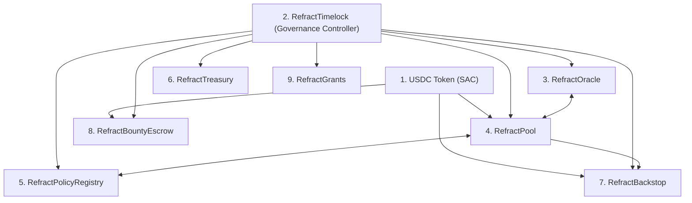

# Deployment & Initialization Order

This document specifies the canonical deployment sequence, initialization entrypoints, and cross-contract address wiring for the Refract protocol contracts, including the four governance-adjacent contracts ([`backstop/`](../backstop/src/lib.rs), [`bounty/`](../bounty/src/lib.rs), [`grants/`](../grants/src/lib.rs), and [`treasury/`](../treasury/src/lib.rs)).

---

## 1. Overview of the Four Governance-Adjacent Contracts

Alongside the core settlement layer ([`RefractPool`](../pool/src/lib.rs), [`RefractPolicyRegistry`](../policy/src/lib.rs), and [`RefractOracle`](../oracle/src/lib.rs)) and the governance execution stack ([`RefractTimelock`](../timelock/src/lib.rs), [`RefractGovernance`](../governance/src/lib.rs), [`RefractVeToken`](../vetoken/src/lib.rs), and [`RefractMultisig`](../multisig/src/lib.rs)), Refract deploys four specialized capital-custody and disbursement contracts:

| Crate | Contract | Role | Authority Model |
|---|---|---|---|
| [`treasury/`](../treasury/src/lib.rs) | `RefractTreasury` | Minimal protocol treasury vault that receives protocol fees via plain token transfers and disburses funds to approved destinations. | `withdraw(caller, token, amount, to)` is gated by `admin` (`RefractTimelock`). |
| [`backstop/`](../backstop/src/lib.rs) | `RefractBackstop` | Second-loss risk-capital tranche. Stakers deposit USDC for shares, earn a configurable basis-point slice of premiums (`premium_share_bps`), and absorb claim shortfalls when primary pool liquidity is insufficient. | `deposit` / `withdraw` are staker-authenticated; `cover_shortfall(caller, amount)` is restricted to `pool` (`RefractPool`) or `admin` (`RefractTimelock`). |
| [`bounty/`](../bounty/src/lib.rs) | `RefractBountyEscrow` | On-chain bug bounty escrow paired with [`SECURITY.md`](../SECURITY.md). Holds bounty funds and records immutable `AwardRecord` entries keyed by `report_hash` (`BytesN<32>`). | `fund(from, amount)` is permissionless; `award(caller, researcher, amount, report_hash)` is strictly gated by `governance` (`RefractTimelock`). |
| [`grants/`](../grants/src/lib.rs) | `RefractGrants` | Milestone-based community grants disbursement contract. Releases funds incrementally as ordered milestones are confirmed. | `create_grant` and `confirm_milestone` require `governance` (`RefractTimelock`); `claim(recipient, grant_id)` is permissionless for the grant `recipient`. |

---

## 2. Dependency Graph & Why Order Matters

Several contracts store immutable or admin-configured references to sibling contracts at initialization time:

1. **Settlement Token (USDC SAC)** must exist first because `RefractPool`, `RefractBackstop`, and `RefractBountyEscrow` require the token address in `initialize`.
2. **Governance / Timelock (`RefractTimelock`)** must be deployed before initializing downstream contracts so its address can be passed directly as `admin` / `governance` (avoiding an extra post-deploy admin transfer window).
3. **`RefractOracle` and `RefractPool`** must be deployed before `RefractPolicyRegistry` and `RefractBackstop`, because both `RefractPolicyRegistry::initialize` and `RefractBackstop::initialize` take the `RefractPool` address.
4. **Bidirectional Pool Wiring** (`RefractPool::set_oracle` and `RefractPool::set_policy_registry`) is executed after `RefractOracle` and `RefractPolicyRegistry` are initialized.
5. **Governance-Adjacent Contracts (`RefractTreasury`, `RefractBackstop`, `RefractBountyEscrow`, `RefractGrants`)** are deployed and initialized once the token, `RefractTimelock`, and `RefractPool` addresses are known.

---

## 3. Step-by-Step Deployment & Initialization Sequence

### Phase 1 — Settlement Token & Governance Root

1. **Resolve or deploy the USDC Stellar Asset Contract (`TOKEN_ADDR`)** on the target network.
2. **Deploy and initialize `RefractTimelock` (`TIMELOCK_ADDR`)**:
   - Call `RefractTimelock::initialize(admin, min_delay)` where `admin` is the bootstrap multisig (`RefractMultisig`) or `RefractGovernance` contract and `min_delay` is at least `86_400` seconds (24 hours).

### Phase 2 — Core Insurance Layer

3. **Deploy and initialize `RefractOracle` (`ORACLE_ADDR`)**:
   - Call `RefractOracle::initialize(admin)` with `admin = TIMELOCK_ADDR` (or bootstrap deployer during initial wiring before handing off to `TIMELOCK_ADDR`).
4. **Deploy and initialize `RefractPool` (`POOL_ADDR`)**:
   - Call `RefractPool::initialize(admin, usdc_token)` with `usdc_token = TOKEN_ADDR`.
5. **Deploy and initialize `RefractPolicyRegistry` (`POLICY_ADDR`)**:
   - Call `RefractPolicyRegistry::initialize(admin, pool_contract)` with `pool_contract = POOL_ADDR`.
6. **Wire `RefractPool` to `RefractOracle` and `RefractPolicyRegistry`**:
   - Call `RefractPool::set_oracle(ORACLE_ADDR)`.
   - Call `RefractPool::set_policy_registry(POLICY_ADDR)`.

### Phase 3 — Four Governance-Adjacent Contracts

7. **Deploy and initialize `RefractTreasury` (`TREASURY_ADDR`)**:
   - Call `RefractTreasury::initialize(admin)` with `admin = TIMELOCK_ADDR`.
   - Protocol fees or initial reserves can now be transferred directly to `TREASURY_ADDR` via standard SEP-41 token transfers.
8. **Deploy and initialize `RefractBackstop` (`BACKSTOP_ADDR`)**:
   - Call `RefractBackstop::initialize(pool, admin, token, premium_share_bps)` with:
     - `pool = POOL_ADDR`
     - `admin = TIMELOCK_ADDR`
     - `token = TOKEN_ADDR`
     - `premium_share_bps` in `0..=10_000` (e.g., `2_000` for 20% of routed premium income).
9. **Deploy and initialize `RefractBountyEscrow` (`BOUNTY_ADDR`)**:
   - Call `RefractBountyEscrow::initialize(governance, token)` with:
     - `governance = TIMELOCK_ADDR`
     - `token = TOKEN_ADDR`
   - Optionally seed the bounty pool from the treasury or deployer via `RefractBountyEscrow::fund(from, amount)`.
10. **Deploy and initialize `RefractGrants` (`GRANTS_ADDR`)**:
    - Instantiate `RefractGrants::new(governance)` with `governance = TIMELOCK_ADDR`.

### Phase 4 — Final Admin Handoff & Verification

11. If a temporary deployer key was used as `admin` on `RefractOracle`, `RefractPool`, or `RefractPolicyRegistry` to perform initial cross-contract wiring in Step 6, transfer admin authority to `TIMELOCK_ADDR` (`set_admin`) and verify every contract's `admin()` / `governance()` view returns `TIMELOCK_ADDR`.

---

## 4. Address-Configuration Matrix

| Step | Contract | Initialization Entrypoint | Required Addresses / Parameters | Post-Deploy Wiring / Funding Calls |
|---|---|---|---|---|
| 1 | USDC Token (SAC) | Asset wrap / network SAC | Asset issuer + code | Mint / fund initial test accounts on testnet |
| 2 | `RefractTimelock` | `initialize(admin, min_delay)` | `admin`: `MULTISIG_ADDR` or `GOV_ADDR` `min_delay`: `u64` (seconds) | Queue/execute governance actions |
| 3 | `RefractOracle` | `initialize(admin)` | `admin`: `TIMELOCK_ADDR` | `register_relayer`, `set_feed_metadata` |
| 4 | `RefractPool` | `initialize(admin, usdc_token)` | `admin`: `TIMELOCK_ADDR` `usdc_token`: `TOKEN_ADDR` | `set_oracle(ORACLE_ADDR)`, `set_policy_registry(POLICY_ADDR)`, `set_guardian(GUARDIAN_ADDR)` |
| 5 | `RefractPolicyRegistry` | `initialize(admin, pool_contract)` | `admin`: `TIMELOCK_ADDR` `pool_contract`: `POOL_ADDR` | Called cross-contract by `RefractPool` |
| 6 | `RefractTreasury` | `initialize(admin)` | `admin`: `TIMELOCK_ADDR` | Receive token transfers; disburse via `withdraw(TIMELOCK_ADDR, TOKEN_ADDR, amount, to)` |
| 7 | `RefractBackstop` | `initialize(pool, admin, token, premium_share_bps)` | `pool`: `POOL_ADDR` `admin`: `TIMELOCK_ADDR` `token`: `TOKEN_ADDR` `premium_share_bps`: `0..=10_000` | Stakers call `deposit`/`withdraw`; `RefractPool` calls `cover_shortfall` |
| 8 | `RefractBountyEscrow` | `initialize(governance, token)` | `governance`: `TIMELOCK_ADDR` `token`: `TOKEN_ADDR` | Top up via `fund(from, amount)`; pay researchers via `award(TIMELOCK_ADDR, researcher, amount, report_hash)` |
| 9 | `RefractGrants` | `new(governance)` | `governance`: `TIMELOCK_ADDR` | Approve via `create_grant`; confirm via `confirm_milestone`; grantees call `claim` |
