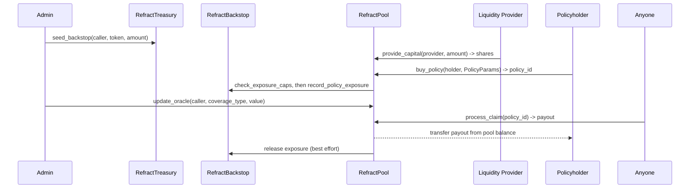

# Protocol Lifecycle Golden Path

This walkthrough describes the call sequence implemented on this branch. Pool,
oracle and treasury entrypoints are named as they appear in `pool/src/lib.rs`,
`oracle/src/lib.rs` and `treasury/src/lib.rs`. Cross-contract client signatures
are in `interfaces/src/clients.rs` (`PoolClient`, `BackstopClient`,
`TreasuryClient`, ...); the interface crate carries no separate trait version, so
this document targets the traits as they stand on this branch.

Notes on what the code does today:

- `PoolInterface::process_claim(env, policy_id) -> Result<Amount, RefractError>`
  is permissionless. The pool checks its own stored `OracleData` for the policy's
  coverage type (written by the admin-only `update_oracle`, and required to be
  under 30 minutes old), not a call into `RefractOracle`.
- The payout is the policy's full `coverage_amount`, paid from the pool's own
  balance. The pool does not call `BackstopClient::draw_down` during
  `process_claim`, and does not route a protocol fee to the treasury or a premium
  share to the backstop in `buy_policy`. `draw_down` and `receive_premium` exist
  on the backstop but nothing in the pool invokes them.
- The backstop is consulted by the pool only for exposure bookkeeping
  (`record_policy_exposure` on purchase, release on claim or expiry).
- `RefractOracle` (`submit`, `is_triggered`) is not on the pool's claim path.
