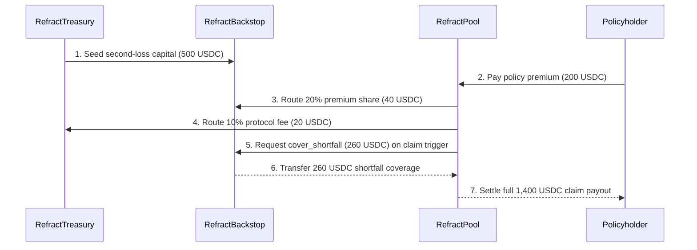

# Protocol Lifecycle Golden-Path Flow (`#263`)

## Invariants Verified

1. **Shortfall Drawdown Variant**: When a parametric trigger claim exceeds `RefractPool` liquidity, `RefractBackstop::cover_shortfall` transfers the exact deficit without burning staker shares, and global token conservation holds across all actors and contracts.
2. **Sufficient Pool Liquidity Variant**: When `RefractPool` covers the claim directly, `RefractBackstop` retains 100% of principal plus its accrued premium share for staker withdrawal.
