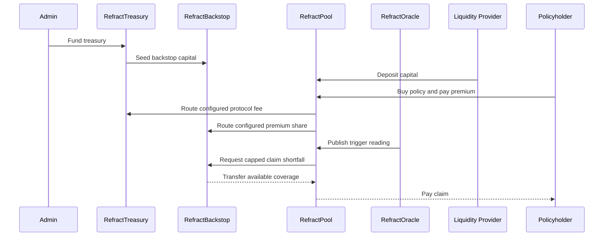

# Protocol Lifecycle Golden Path

The pool checks a configured Oracle reading before claim settlement, routes the configured protocol fee to treasury and premium share to the backstop, and draws only a shortfall when the pool's token balance cannot cover a triggered claim. The backstop tracks allocation, loss, and premium contribution per registered pool; staker withdrawals cannot consume reserved allocations. Bounty and grant payout fees accrue separately and are permissionlessly swept to the configured treasury.